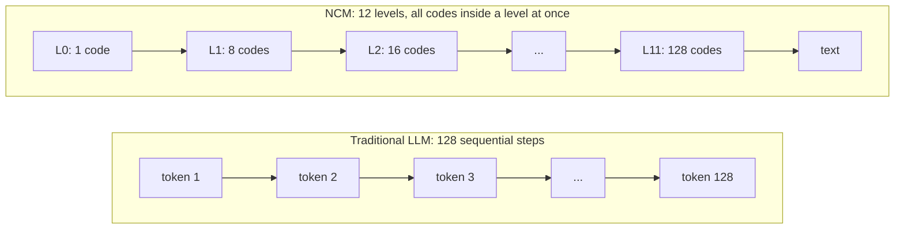
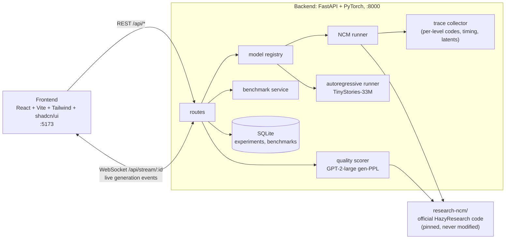

# NCM Research Playground

A hands-on lab for **Next-Concept Modeling (NCM)**, a new way for language models to write text, compared side by side with a traditional token-by-token LLM.

You can run the official NCM models, watch them build text from a rough sketch to a finished story, inspect the discrete "concept codes" they generate at each level, and benchmark them against an ordinary autoregressive model on your own machine.

> **New here?** Read [What we're trying to do](#what-were-trying-to-do) and [How NCM works](#how-ncm-works), then follow [Setup](#setup-step-by-step). It takes about 20 minutes, most of it downloads.

---

## What we're trying to do

In late 2026, Stanford's Hazy Research group published [Next-Concept Modeling](https://arxiv.org/abs/2610.14162) with code and weights at [HazyResearch/ncm](https://github.com/HazyResearch/ncm). It reports generating text **10–31× faster than diffusion language models**. Popular summaries quickly turned that into "NCM beats LLMs", which is **not** what the paper measured: its main comparison is against diffusion models, on an H100 GPU.

This project asks the practical questions:

1. **Does it actually run, and does it reproduce?** We run the *official* code and checkpoints unmodified and re-run the official evaluation.
2. **What is it really doing inside?** We record every level of the coarse-to-fine generation, the codes, timings and intermediate text, without inventing anything the model does not produce.
3. **How does it compare with a normal LLM?** We put NCM next to a same-domain autoregressive model (TinyStories-33M) on the same machine, measuring speed *and* quality, and list every way the comparison is not like-for-like.

**What we found so far** (Apple M5 Pro, CPU; full tables in [`ncm-research-playground/README.md`](ncm-research-playground/README.md)):

| | NCM-TinyStories | TinyStories-33M (normal LLM) |
|---|---|---|
| Sequential model steps for 128 tokens | **11** | 128 |
| Median time, batch 1 / batch 4 | **308 ms / 734 ms** | 437 ms / 1.31 s |
| Time until you see *something* | 308 ms (whole text at once) | **4 ms** (first word) |
| Fluency, gen-PPL under GPT-2-large (lower = better) | 13.48 | **9.74** |

- NCM finishes the whole text **1.4–1.8× faster** here, but the classic LLM shows its first word almost instantly and writes more fluent text.
- The official TinyStories evaluation reproduces closely: gen-PPL **16.23 ± 0.48** vs. **15.41** in the paper.

---

## How NCM works

A normal LLM writes **one token at a time, left to right**: 128 tokens need 128 sequential forward passes.

NCM writes **one level at a time, coarse to fine**. Each level is a whole-sequence "sketch" made of discrete codes. Level 0 is a single code summarising the entire text; the last level has one code per token. Every code within a level is predicted **in parallel**, so 128 tokens need only about a dozen sequential steps.



It has two parts, both released as frozen checkpoints:

**1. A tokenizer that turns text into a hierarchy of codes** (a *multiscale residual VQ-VAE*)
- Text → 128 BPE tokens → an encoder produces a continuous latent (128 positions × 384 numbers).
- That latent is approximated by **12 levels of discrete codes** with lengths 1, 8, 16, 24, 32, 40, 52, 64, 76, 92, 108, 128. Each level has its own codebook of 4096 entries.
- The levels are **residual**: each one encodes what the coarser levels before it missed. Adding all levels (each upsampled to full length) back together recreates the latent, and a decoder turns it back into tokens.

**2. A "next-concept" transformer that generates those codes**
- Given the sum of everything generated so far (levels 0…k), it predicts **all codes of level k+1 in one forward pass**.
- Repeat until the finest level, then decode the final latent into text.
- For TinyStories, level 0 is sampled from a code-frequency table stored in the checkpoint, so it takes 11 transformer passes in total.
- For summarisation (XSum) and translation (WMT14), the input text is fed in as a prefix, and the model also predicts level 0.

Decoding the partial latent after each level shows the coarse-to-fine process. These are real outputs of the official `decode_multiscales` function:

```
L0  (1 code)    .
L3  (24 codes)  One named the and.. and " is a it He felt wanted for before ...
L7  (64 codes)  day a boy found shiny in the. was happy showed his,. looked the ...
L11 (128 codes) One day, a little boy named Tim found a shiny stone in the park. He was very happy...
```

---

## Architecture



- **`research-ncm/`**: the official repository, cloned at a pinned commit. The app *imports* it and never edits it, so every result comes from the real implementation.
- **Backend**
  - Loads models once and keeps them in memory.
  - Runs one generation at a time, so timings are fair.
  - Streams real events (`model.loading`, `generation.level_completed`, `generation.step_completed`, …) over WebSocket.
  - Stores every run in SQLite.
- **Trace collector:** briefly wraps the two internal methods the official generation loop calls once per level, so it can record codes and timings as they happen, then puts them back.
- **Frontend sections**
  - **Playground**: run a model.
  - **Concept Explorer**: code heatmaps and per-level text.
  - **Generation Timeline**: the recorded execution on a time axis.
  - **Model Comparison**: NCM vs. the baseline.
  - **Benchmarks**: medians, percentiles, CSV export.
  - **Experiment History**: replay and re-run past runs.

---

## Setup (step by step)

### 1. What you need

| | Version used | Install (macOS) |
|---|---|---|
| Git | any | comes with Xcode command line tools: `xcode-select --install` |
| [uv](https://docs.astral.sh/uv/) | 0.11 | `brew install uv` |
| Node.js | 26 (20+ should work) | `brew install node` |
| Disk | ~6 GB free | checkpoints 2.2 GB, GPT-2-large judge 3.1 GB, baseline 0.3 GB |
| RAM | 16 GB+ recommended | the GPT-2-large quality judge alone needs ~3 GB |

You do **not** need a GPU; everything runs on CPU. Linux works with the same commands. Python 3.12 is installed for you by `uv` in step 3.

### 2. Get the code

```bash
git clone https://github.com/Nishaanth419/ncm-research-playground.git
```

```bash
cd ncm-research-playground/ncm-research-playground
```

(The repository and the app folder share a name; all following commands run from the inner folder. While the repository is private, cloning needs a GitHub account that has been given access.)

Add the official NCM implementation at the exact commit this project was built against:

```bash
git clone https://github.com/HazyResearch/ncm research-ncm
```

```bash
git -C research-ncm checkout c70274273f489abc73832b2b98584a8483b6b203
```

### 3. Python environment

```bash
uv venv --python 3.12 .venv
```

```bash
uv pip install --python .venv/bin/python -r backend/requirements.txt
```

### 4. Download the models (one time, ~6 GB)

NCM checkpoints and test sets, at pinned versions:

```bash
cd research-ncm && ../.venv/bin/python -c "from huggingface_hub import snapshot_download as d; d('hazyresearch/ncm-checkpoints', revision='d342ce8aaea58830eef3b8ad473664673e41f692', allow_patterns=['tinystories/*','xsum/*','wmt14/*'], local_dir='artifacts'); d('hazyresearch/ncm-datasets', repo_type='dataset', revision='6580ba41a4b0a976dde876fbe84d25327617b0e6', allow_patterns=['xsum/*','wmt14/*'], local_dir='data')" && cd ..
```

The autoregressive baseline and the quality judge:

```bash
.venv/bin/python -c "from huggingface_hub import snapshot_download as d; d('roneneldan/TinyStories-33M', revision='2ad0a164221b7c4d21cac7c46aec74f6f98dbfc8'); d('gpt2-large')"
```

A "sending unauthenticated requests to the HF Hub" warning is harmless; downloads are just slower without a Hugging Face token.

### 5. Frontend packages

```bash
cd frontend && npm install && cd ..
```

### 6. Check that it works (optional, ~1 minute)

```bash
.venv/bin/python experiments/smoke_tinystories.py --device cpu --n 2
```

You should see two short stories and the level-by-level decodes.

---

## Run

From `ncm-research-playground/ncm-research-playground`, start both servers with one command:

```bash
./run.sh
```

It checks that setup is done and that ports 8000 and 5173 are free, then starts the backend and the frontend together. Their logs are interleaved and tagged `[backend]` / `[frontend]`. **Ctrl+C stops both**, and if either one crashes the other is stopped too. Settings such as `NCM_DEVICE=cuda ./run.sh` pass through. You can move the ports with `BACKEND_PORT=8010 FRONTEND_PORT=5180 ./run.sh`.

Then open **http://localhost:5173**. The backend's interactive API docs are at http://127.0.0.1:8000/docs.

<details>
<summary>Or start them separately, in two terminals</summary>

Terminal 1, the backend:

```bash
cd backend && ../.venv/bin/uvicorn --factory app.main:create_app --host 127.0.0.1 --port 8000
```

Terminal 2, the frontend:

```bash
cd frontend && npm run dev
```

</details>

### Things to try first

0. **Learn NCM**, if you are new to it: a plain-language guide with the paper, our findings and videos.
1. **How NCM works → Play.** An animated walk-through of a real run: NCM fills the whole canvas in 11 passes while a traditional model needs 128, then the story sharpens level by level.
1. **Playground → `ncm-tinystories` → Generate.** Watch the 12 level cells fill as real events arrive. The first run also loads the checkpoint (a few seconds).
2. Click **concepts →** on the result to open the **Concept Explorer**. Click any level to see its codes and the text decoded at that point.
3. **Playground → `ncm-xsum` → Official test example → Generate** for a news summary, with the human reference shown next to it.
4. **Model Comparison → Run comparison** runs NCM against TinyStories-33M with identical settings, scores both for fluency, and lists the caveats.
5. **Benchmarks → Run benchmark** (about a minute) for medians and p95 latencies you can download as CSV.

### Tests

```bash
cd backend && ../.venv/bin/pytest -q
```

```bash
cd frontend && npm test
```

Tests that need the downloaded models skip themselves if the models are missing.

---

## Troubleshooting

| Problem | Fix |
|---|---|
| Sidebar says **backend offline** | Start the backend (terminal 1). The page retries every 3 s. |
| `address already in use` on 8000 or 5173 | Another process holds the port; stop it, or start the backend on another port and run the frontend with `NCM_BACKEND_URL=http://127.0.0.1:<port> npm run dev`. |
| A model shows **checkpoint missing** | Re-run step 4; check that `research-ncm/artifacts/<task>/generator.pt` exists. |
| `Adaptive pool MPS: input sizes must be divisible…` | You set `NCM_DEVICE=mps`. The official quantizer does not run on Apple GPUs yet; use the default `cpu`. |
| First generation or first quality score is slow | Models load on first use (NCM ~2–6 s, GPT-2-large ~10 s) and then stay in memory. |
| A run shows *interrupted: the server restarted* | The backend was restarted while it was running; just run it again. |

---

## Repository layout

```
.
├─ README.md                          you are here
├─ docs/superpowers/                  original experiment spec and plan
└─ ncm-research-playground/
   ├─ README.md                       detailed reference: results, faithfulness, API, limitations
   ├─ backend/                        FastAPI app, runners, trace collector, benchmarks, tests
   ├─ frontend/                       React research workspace
   ├─ experiments/                    standalone scripts (smoke test, official-script CPU launcher, level probe)
   ├─ docs/ASSESSMENT.md              architecture study and machine compatibility
   ├─ docs/IMPLEMENTATION_LOG.md      every milestone: commands, results, issues
   ├─ results/                        logs, official eval outputs, benchmark CSVs
   └─ research-ncm/                   official NCM code + downloaded models (not in git; created in setup)
```

## Credits

- NCM: Kumbong, Khare, Mlauzi, Woen, Ding, Buchanan, Arora, Mirhoseini, Ré. *Next-Concept Modeling: Fast, Parallel Coarse-to-Fine Text Generation*, 2026. [Paper](https://arxiv.org/abs/2610.14162), [code](https://github.com/HazyResearch/ncm) (MIT).
- Baseline: [roneneldan/TinyStories-33M](https://huggingface.co/roneneldan/TinyStories-33M).
- Quality judge: [GPT-2-large](https://huggingface.co/gpt2-large), as in the official NCM evaluation.
