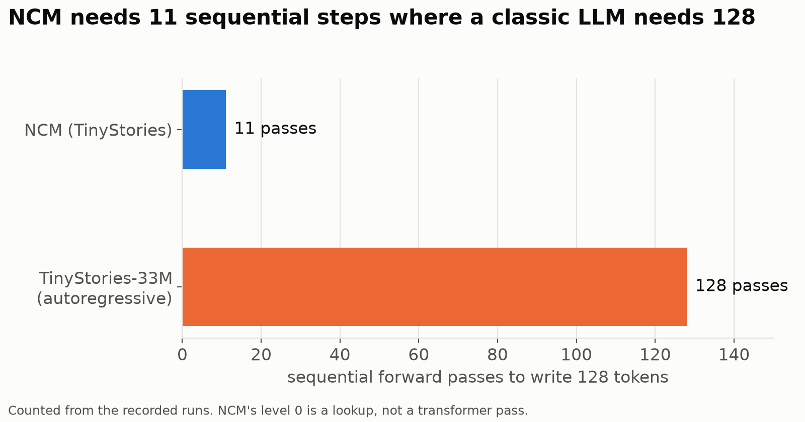
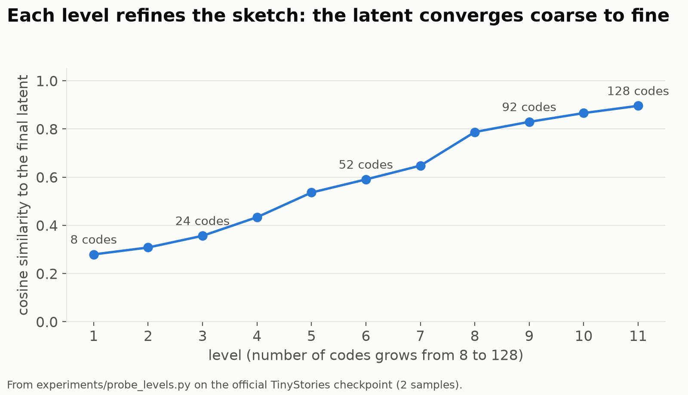
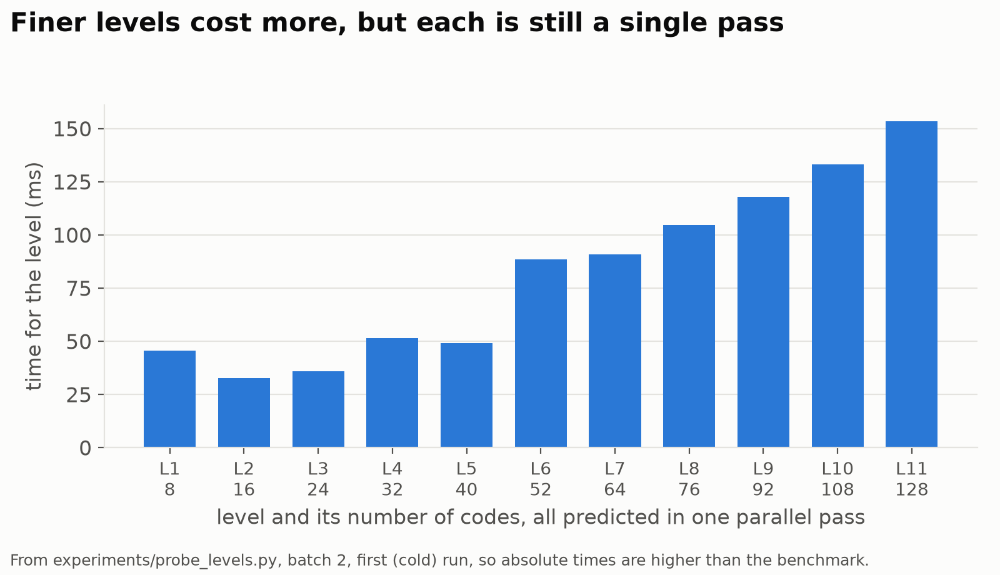
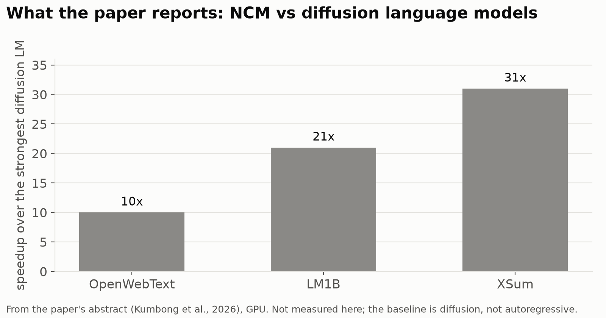
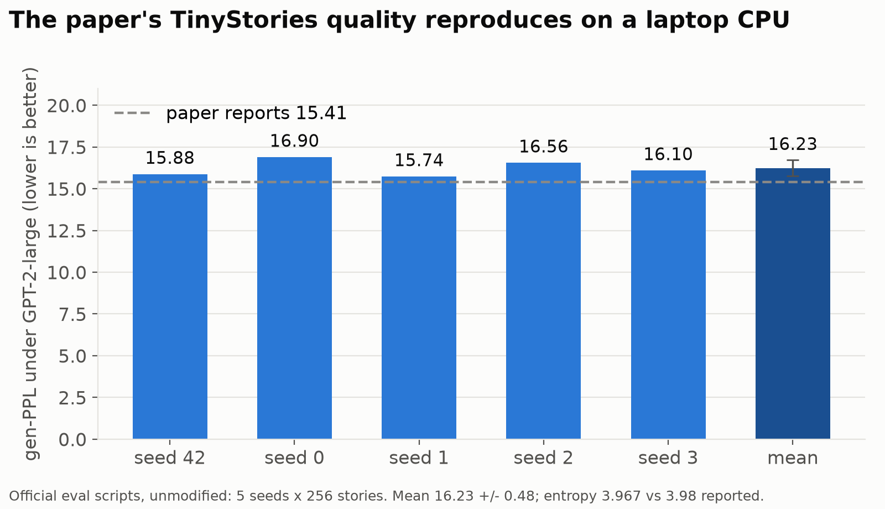
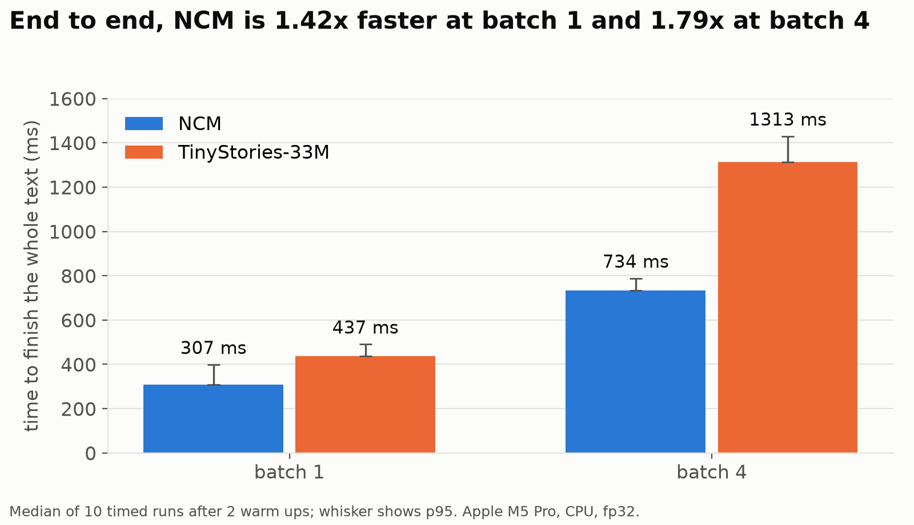
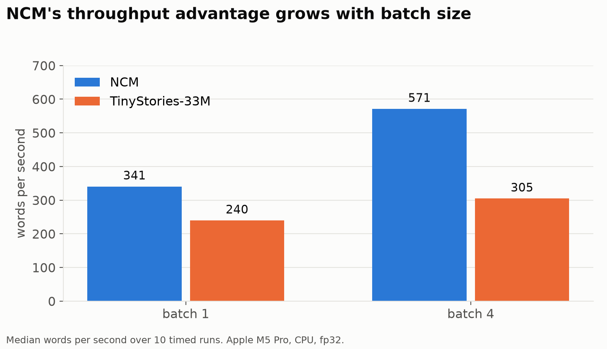
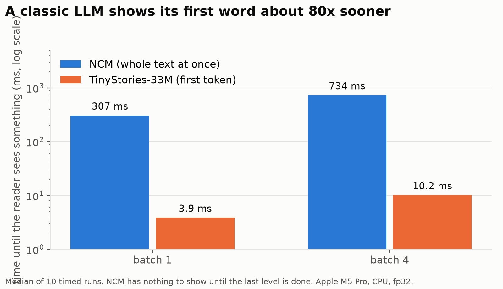
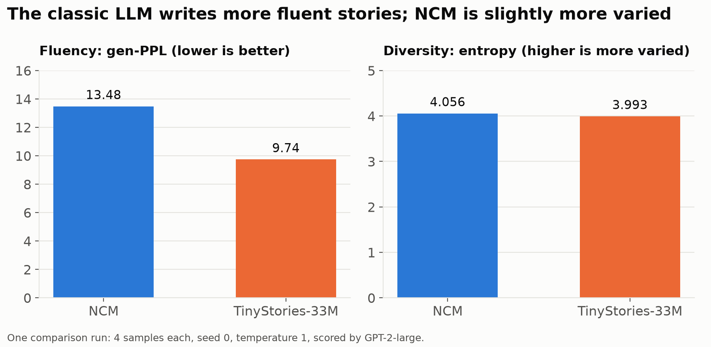

Every large language model you have used, from GPT to Llama to Claude, writes text the same way: one token at a time, left to right. To produce 128 tokens it runs the network 128 times in a row, and each step has to wait for the previous one. That sequential loop is the single biggest reason text generation is slow and expensive.

In October 2026, Stanford's Hazy Research group published **Next-Concept Modeling (NCM)**, a model that writes text a completely different way: it sketches the whole passage first, then refines it level by level, predicting every position of a level in parallel. The paper reports generation that is 10x to 31x faster than diffusion language models at comparable quality.

Social media quickly turned that into "NCM kills LLMs". That is not what the paper measured. So I did what any curious engineer would do: I ran the official code and checkpoints myself, rebuilt the paper's evaluation, and put NCM head to head against a traditional autoregressive model trained on the same data, on an ordinary laptop.

This post covers:

1. Why a new way of generating text is needed
2. How NCM works, in plain language
3. What the paper claims
4. The datasets and models I used
5. My experiments and results, with graphs
6. The future of NCM, and whether it will replace LLMs

Everything is open source in my repository: **[github.com/Nishaanth419/ncm-research-playground](https://github.com/Nishaanth419/ncm-research-playground)**.

## Why do we need something other than next-token prediction?

An autoregressive (AR) language model predicts the next token given all previous tokens. It is simple, it scales beautifully, and it powers almost every chatbot today. But it has a structural cost:

* **Latency grows linearly with length.** 1,000 tokens means 1,000 sequential forward passes. A GPU can do enormous amounts of work in parallel, but it cannot skip ahead.
* **It commits early.** The model picks word 1 before it has "decided" what word 50 will be. Any global plan has to live implicitly inside its hidden state.
* **Throughput is bounded by memory bandwidth**, because each tiny step reloads the weights.

Researchers have tried to break this loop before. **Diffusion language models** start from noise or masked tokens and refine all positions at once over many steps. They are parallel, but usually need many refinement steps to reach good quality, so in practice they are often not faster.

NCM takes a third route, borrowed from image generation.

## How NCM works

The idea comes from **VAR (Visual Autoregressive Modeling)**, which generates an image by predicting a tiny thumbnail first and then progressively larger, sharper versions. NCM applies the same coarse to fine recipe to text.

It has two parts.

### Part 1: a tokenizer that turns text into levels of "concepts"

A **multiscale residual VQ-VAE** compresses a passage into a stack of levels of discrete codes.

* Text is split into 128 ordinary BPE tokens, and an encoder turns them into a continuous latent (128 positions by 384 numbers).
* That latent is approximated by **12 levels** of codes. For TinyStories the level lengths are **1, 8, 16, 24, 32, 40, 52, 64, 76, 92, 108 and 128**. Each level picks codes from its own codebook of 4,096 entries.
* The levels are **residual**: each level encodes only what the coarser levels missed. Upsample every level to full length, add them together, and a decoder turns the sum back into tokens.

Level 0 is a single code that summarizes the entire passage. The last level has one code per token. These codes are the "concepts" in the name.

### Part 2: a transformer that predicts the next level, not the next token

A **next-concept transformer** looks at everything generated so far (levels 0 to k, summed) and predicts **all codes of level k+1 in a single forward pass**. Repeat until the finest level, then decode the final latent into text.

For a 128-token story, that is **11 transformer passes instead of 128**. (Level 0 for TinyStories is sampled from a frequency table stored in the checkpoint, so it costs no transformer pass.)



### Watching it think

The nicest property of NCM is that every intermediate level can be decoded. These are real outputs of the official `decode_multiscales` function from one of my runs:

```
L0  (1 code)    .
L3  (24 codes)  One named the and.. and " is a it He felt wanted for before ...
L7  (64 codes)  day a boy found shiny in the. was happy showed his,. looked the ...
L11 (128 codes) One day, a little boy named Tim found a shiny stone in the park. He was very happy...
```

Early levels look like word salad, but they already carry the cast and topic of the story. The grammar and exact wording arrive in the last few levels. I measured this numerically by comparing the latent after each level with the final one:



Each level is one parallel step, but finer levels contain more codes, so they take longer:



### The trade off you should notice immediately

Because the text only becomes readable at the last level, **NCM cannot stream**. A chatbot built on an AR model shows you its first word in milliseconds; NCM shows you nothing until the whole passage is finished. Keep that in mind for the results.

## What the paper claims

**Paper:** *Next-Concept Modeling: Fast, Parallel Coarse-to-Fine Text Generation*, by Hermann Kumbong, Ishan S. Khare, Iddah Mlauzi, Andrew Woen, Charles Ding, E. Kelly Buchanan, Simran Arora, Azalia Mirhoseini and Christopher Ré (Stanford, 2026). [arXiv:2610.14162](https://arxiv.org/abs/2610.14162)

From the abstract, compared with the strongest **diffusion** language model baseline at matched scale:

* **LM1B:** better generative perplexity, about **21x faster**
* **OpenWebText:** competitive quality, about **10x faster**
* **XSum summarization:** matches ROUGE-L, about **31x faster**
* **Sudoku:** outperforms both autoregressive and diffusion baselines at every difficulty level, with fewer function evaluations



Two details matter when you read those numbers. First, the baseline is a **diffusion** model, not a standard autoregressive LLM. Second, the speeds were measured on a datacenter GPU (an H100). Neither of those matches how most people will first try NCM, which is exactly why I ran my own experiments.

The authors released everything: [code](https://github.com/HazyResearch/ncm) under the MIT license, [checkpoints and datasets](https://huggingface.co/collections/hazyresearch/ncm) on Hugging Face, and a [blog post](https://hazyresearch.stanford.edu/blog/2026-10-12-ncm).

## My experiment setup

**Question:** How does NCM compare with a traditional autoregressive model of the same domain, on speed and on text quality, on ordinary hardware? And do the paper's numbers reproduce from the released code?

**Hardware:** Apple M5 Pro laptop, **CPU only**, fp32, 6 threads. (NCM does not currently run on Apple's GPU backend: PyTorch MPS lacks the adaptive pooling NCM's quantizer uses.)

**Software:** Python 3.12, PyTorch 2.15, Transformers 5.22. The official NCM repository is pinned at commit `c70274273f489abc73832b2b98584a8483b6b203` and is **never modified**; my code imports it.

### Models

| Role | Model | Size |
|---|---|---|
| NCM, stories | [`hazyresearch/ncm-checkpoints`](https://huggingface.co/hazyresearch/ncm-checkpoints), `tinystories/` | 125.0M (generator 88.6M + VQ-VAE 36.4M) |
| NCM, summarization | same repository, `xsum/` | |
| NCM, translation | same repository, `wmt14/` | |
| Autoregressive baseline | [`roneneldan/TinyStories-33M`](https://huggingface.co/roneneldan/TinyStories-33M) | 68.5M |
| Quality judge | [`gpt2-large`](https://huggingface.co/gpt2-large) | 774M |

Both story models were trained on the same dataset, which is what makes them a reasonable pair.

### Datasets

| Dataset | What it is | How I used it | Link |
|---|---|---|---|
| **TinyStories** (Eldan and Li, 2023) | Short synthetic children's stories written with a small vocabulary | Training data of both story models. Generation is unconditional, so the models' own samples are scored. | [HF dataset](https://huggingface.co/datasets/roneneldan/TinyStories) |
| **XSum** (Narayan et al., 2018) | BBC news articles with one sentence summaries; 11,334 test pairs | NCM summarization, test items 0 to 3 | [NCM copy](https://huggingface.co/datasets/hazyresearch/ncm-datasets/tree/main/xsum) |
| **WMT14 German to English** | News sentence pairs; 3,003 test pairs | NCM translation, test items 0 to 3 | [NCM copy](https://huggingface.co/datasets/hazyresearch/ncm-datasets/tree/main/wmt14) |

### Metrics

* **Generative perplexity (gen-PPL):** how surprised GPT-2-large is by the generated text. Lower means more fluent. This is the metric the NCM paper uses.
* **Unigram entropy:** how varied the words are. It guards against a model that games perplexity by repeating itself.
* **Latency:** median and p95 wall clock time over repeated runs, after warm up.
* **Time to first output:** when the reader first sees anything.

## Results

### Experiment 1: Does the paper's result reproduce?

I ran the official evaluation scripts unmodified (`eval_shard.py` and `eval_merge.py`): 5 seeds by 256 unconditional TinyStories samples, scored by GPT-2-large. The scripts assume CUDA, so a small launcher remaps device requests to CPU without touching the code.



| | gen-PPL | entropy |
|---|---|---|
| My reproduction (5 seeds, 1,280 stories) | **16.23 ± 0.48** | **3.967** |
| Paper, Table 8 | 15.41 | 3.98 |

**Verdict: it reproduces.** Entropy matches, and gen-PPL is within two seed standard deviations. The small gap is plausibly CPU fp32 and newer library versions. Generation of all 1,280 stories took 4.5 minutes; scoring took 18.5 minutes.

### Experiment 2: Is my app running the model faithfully?

I built a research playground (FastAPI backend, React frontend) that runs NCM through its own code path so it can record every level. To make sure I was not measuring my own bugs, I compared its outputs with the official script's outputs for the same inputs and seeds.

**Verdict: identical** for TinyStories (seed 42, 4 samples), XSum test items 0 to 3 and WMT14 test items 0 to 3. This is enforced by automated tests in the repository.

### Experiment 3: Speed against a classic LLM

Benchmark protocol: for each model and batch size, 2 untimed warm ups, then 10 timed runs with seeds 0 to 9, checkpoint default sampling (temperature 1, no top k or top p).



| Model | Batch | Median | p95 | Per sample | Words/s |
|---|---|---|---|---|---|
| NCM | 1 | 307.5 ms | 399.3 ms | 307.5 ms | 340.6 |
| NCM | 4 | 733.7 ms | 788.8 ms | 183.4 ms | 571.1 |
| TinyStories-33M | 1 | 436.9 ms | 491.3 ms | 436.9 ms | 239.5 |
| TinyStories-33M | 4 | 1313.0 ms | 1430.3 ms | 328.2 ms | 304.7 |

NCM finishes a whole story **1.42x faster at batch 1 and 1.79x faster at batch 4**, and the gap widens with batch size, because each of its 11 passes does more parallel work:



But look at when the reader sees something:



The autoregressive model shows its **first token in 3.9 ms**. NCM shows the complete text at 307 ms and nothing before that. For a chat interface, perceived speed is mostly about that first token, and there the classic model wins by roughly 80x.

### Experiment 4: Quality head to head

Same seed, same batch of 4, same sampling, both warmed up, scored by GPT-2-large.



The autoregressive baseline writes noticeably **more fluent** text (gen-PPL 9.74 vs 13.48). NCM is slightly **more varied** (entropy 4.056 vs 3.993). This is a single small run, so treat it as an indication rather than a final verdict, but it matches what I saw reading the stories side by side.

### Summarization and translation

The XSum and WMT14 checkpoints run and accept real input. They work, but show visible repetition in some outputs. For example, the German sentence "Ich trinke gern Kaffee am Morgen." came back as "I like like coffee in the morning." I did not run the full 11,334 and 3,003 item evaluations on CPU, only the 4 item exact match checks.

### Read these numbers carefully

* The paper's 10x to 31x speedups are **GPU numbers against diffusion models**. Mine are **CPU numbers against an autoregressive model**. Different experiments, not a contradiction.
* The two story models differ in size (125M vs 68.5M), tokenizer (8,192 entry BPE vs GPT-2 BPE) and training run.
* NCM always fills its 128 token canvas; the baseline may stop early at end of text.
* The speed results are medians of 10 runs; the quality comparison is one 4 sample run.

## What I built along the way

The [repository](https://github.com/Nishaanth419/ncm-research-playground) is a full research playground you can run locally with one command (`./run.sh`):

* **Learn NCM:** a plain language guide with the paper, findings, videos and a glossary
* **How NCM works:** an animated walkthrough replayed from a real recorded run
* **Playground:** run TinyStories, XSum or WMT14, watching levels fill in live over WebSocket
* **Concept Explorer:** heatmaps of the code hierarchy and the text decoded at each level
* **Model Comparison and Benchmarks:** the experiments in this post, exportable as CSV
* **Experiment History:** every run stored in SQLite, replayable

Every number in this post comes from files committed in the repository (`results/`), and the graphs are generated by [`blog/make_charts.py`](https://github.com/Nishaanth419/ncm-research-playground/blob/main/blog/make_charts.py) directly from those files.

## The future of NCM

NCM is a few weeks old, and the released checkpoints are small research models. Here is where I think it goes next.

**1. Scaling.** The big open question is whether NCM keeps its quality as models grow to billions of parameters and passages grow to thousands of tokens. The paper's OpenWebText results (1,024 tokens) are encouraging, but nobody has shown an NCM model at the scale of a modern assistant.

**2. Prompting and instructions.** The TinyStories model is unconditional; it cannot take a prompt. XSum and WMT14 show that conditioning on an input works. Instruction following, multi turn chat and tool use are still unexplored.

**3. Streaming, or something better.** NCM cannot show partial words, but it could show a partial *plan*. A product might display an outline from the coarse levels and sharpen it, the way progressive JPEGs load. Or levels could be generated in chunks so long documents stream paragraph by paragraph.

**4. Planning and reasoning.** The Sudoku result is the most intriguing line in the paper. A model that decides the global structure before the details is a natural fit for tasks where the end constrains the beginning: puzzles, code with matching brackets, structured data, poetry with a fixed form.

**5. Hybrids.** The likeliest near term path is not NCM alone but NCM inside a larger system: a fast coarse to fine drafter whose output an autoregressive model verifies or polishes, similar to speculative decoding.

**6. Hardware support.** Today NCM runs on CUDA and CPU but not Apple GPUs. Broader kernel support would make it practical on laptops and phones, where its low step count matters most.

## So, will NCM replace LLMs?

**Not as things stand, and probably not in the "one replaces the other" sense.** A few reasons:

* **Quality still favors autoregressive models** in my test, and the paper's quality comparisons are against diffusion models, not frontier AR LLMs.
* **Streaming matters for chat.** Users perceive a model that starts talking in 4 ms as faster than one that delivers a full answer in 300 ms.
* **The AR ecosystem is enormous.** Instruction tuning, RLHF, KV caching, speculative decoding and serving stacks are all built around next-token prediction.

It is also worth being precise about terminology: NCM *is* a language model. The real question is whether coarse to fine generation will replace left to right generation. My honest prediction:

* NCM style models will **win where throughput matters more than first token latency**: batch summarization, translation, data generation, offline document processing and structured outputs.
* They will **complement rather than replace** autoregressive models in interactive assistants, most likely through hybrids.
* If scaling works out, the parallel step count is a genuine structural advantage, and the "next token" assumption will no longer be the only way to build a large language model. That alone makes NCM one of the most interesting papers of the year.

## Try it yourself

```bash
git clone https://github.com/Nishaanth419/ncm-research-playground.git
cd ncm-research-playground/ncm-research-playground
```

Then follow the step by step setup in the [README](https://github.com/Nishaanth419/ncm-research-playground#setup-step-by-step). It takes about 20 minutes, mostly downloads, and needs no GPU.

## Recommended videos

These are third party explainers I found useful (not reviewed for accuracy):

* [NCM: Fast Parallel Coarse-to-Fine Text Generation](https://www.youtube.com/watch?v=z3CoFbZhYGA), AI Research Roundup: a paper walkthrough
* [Stanford's NCM: Generate Text Without Predicting Every Token?](https://www.youtube.com/watch?v=cysJAICGEiA), AgenticEngineering: the code hierarchy explained
* [Next-Concept Modeling Explained: Can AI Move Beyond Tokens?](https://www.youtube.com/watch?v=J0tqdxQ8PHg), KeepItTechie: a beginner friendly overview
* [NCM Is this the End of LLMs?](https://www.youtube.com/watch?v=vLqswKyHS64), Kai: a skeptical look at the 31x claim
* [Vector-Quantized Variational Autoencoders (VQ-VAEs)](https://www.youtube.com/watch?v=yQvELPjmyn0), DeepBean: background on the tokenizer NCM builds on

## References

1. Kumbong, H., Khare, I. S., Mlauzi, I., Woen, A., Ding, C., Buchanan, E. K., Arora, S., Mirhoseini, A., and Ré, C. (2026). *Next-Concept Modeling: Fast, Parallel Coarse-to-Fine Text Generation.* arXiv:2610.14162. https://arxiv.org/abs/2610.14162
2. HazyResearch. *NCM official code* (MIT license). https://github.com/HazyResearch/ncm
3. HazyResearch. *NCM checkpoints and datasets* on Hugging Face. https://huggingface.co/collections/hazyresearch/ncm
4. Hazy Research blog. *Next-Concept Modeling.* https://hazyresearch.stanford.edu/blog/2026-10-12-ncm
5. Scaling Intelligence Lab blog. *NCM.* https://scalingintelligence.stanford.edu/blogs/ncm/
6. Tian, K., Jiang, Y., Yuan, Z., Peng, B., and Wang, L. (2024). *Visual Autoregressive Modeling: Scalable Image Generation via Next-Scale Prediction.* NeurIPS 2024. https://arxiv.org/abs/2404.02905
7. van den Oord, A., Vinyals, O., and Kavukcuoglu, K. (2017). *Neural Discrete Representation Learning* (VQ-VAE). https://arxiv.org/abs/1711.00937
8. Eldan, R., and Li, Y. (2023). *TinyStories: How Small Can Language Models Be and Still Speak Coherent English?* https://arxiv.org/abs/2305.07759. Dataset: https://huggingface.co/datasets/roneneldan/TinyStories
9. Narayan, S., Cohen, S. B., and Lapata, M. (2018). *Don't Give Me the Details, Just the Summary! Topic-Aware Convolutional Neural Networks for Extreme Summarization* (XSum). https://arxiv.org/abs/1808.08745
10. Bojar, O., et al. (2014). *Findings of the 2014 Workshop on Statistical Machine Translation* (WMT14). https://aclanthology.org/W14-3302/
11. Radford, A., Wu, J., Child, R., Luan, D., Amodei, D., and Sutskever, I. (2019). *Language Models are Unsupervised Multitask Learners* (GPT-2). https://huggingface.co/gpt2-large
12. TinyStories-33M baseline model. https://huggingface.co/roneneldan/TinyStories-33M
13. My repository: *NCM Research Playground.* https://github.com/Nishaanth419/ncm-research-playground

*If you run the playground on a GPU or try NCM on a new task, I would love to hear what you find. Drop a comment below.*
